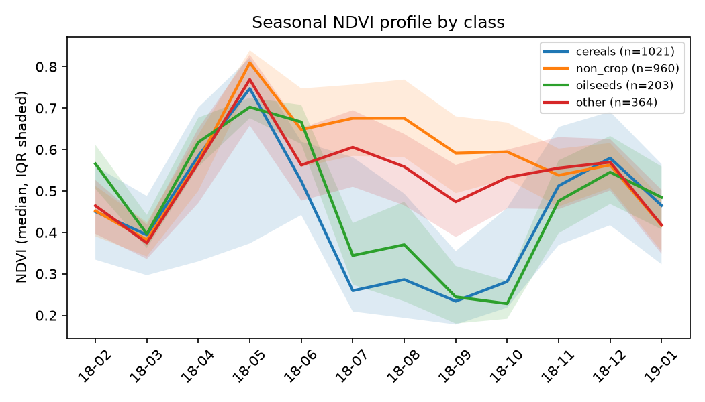
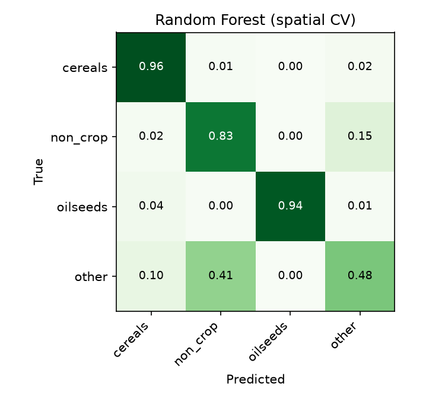
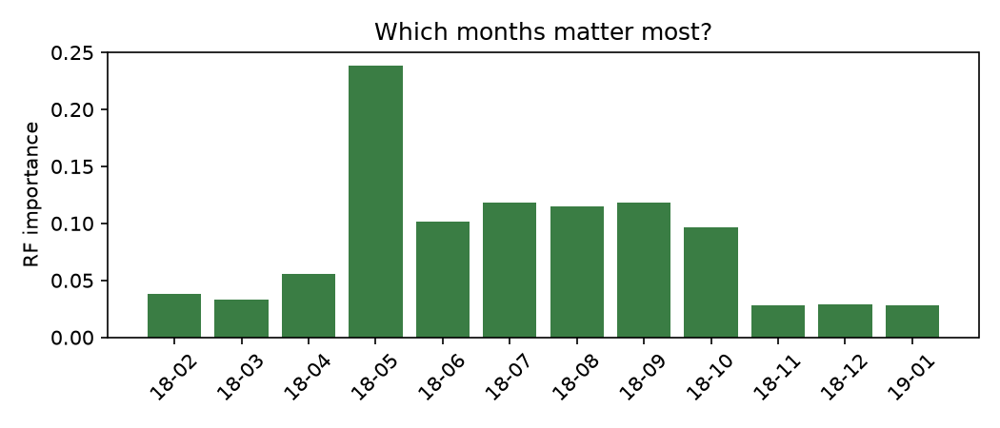

# 01 · Crop type mapping from Sentinel-2 time series

**Question:** can we tell what is growing in a field from a year of satellite images alone?

Each field becomes a 12-month time series of Sentinel-2 reflectance (10 bands plus NDVI). Models learn crop-specific seasonal patterns: winter cereals green up early and are harvested in July, rapeseed (oilseeds) flowers in spring, grassland stays green all year.

- **Region:** ~25 × 25 km east of Berlin, Germany (Brandenburg), 2018 season
- **Labels:** [CropHarvest](https://github.com/nasaharvest/cropharvest) (Tseng et al., NeurIPS 2021), dataset `germany`, 2,550 fields (2,548 with enough clear observations)
- **Imagery:** Sentinel-2 L2A from [Microsoft Planetary Computer](https://planetarycomputer.microsoft.com/dataset/sentinel-2-l2a), cloud-masked with the scene classification layer, monthly median composites at 20 m

## Results

5-fold cross-validation on 2,548 fields, 4 classes. Spatial CV holds out whole 2 km blocks (143 blocks in total).

| Model | Split | Accuracy | Macro-F1 |
|---|---|---|---|
| Random Forest (300 trees) | random CV | 0.862 | 0.832 |
| Random Forest (300 trees) | **spatial CV** | **0.842** | **0.809** |
| Linear (reference for deep models) | spatial CV | 0.815 | 0.795 |
| TempCNN | spatial CV | *your turn: exercise 2* | |
| LSTM | spatial CV | *your turn: exercise 3* | |

Per-class F1 for the Random Forest under spatial CV: cereals 0.95, oilseeds 0.96, non-crop 0.83, other 0.49. All numbers are in [`results/metrics.json`](results/metrics.json).

**What we learned**

- **Random splits overstate performance.** Moving from random to spatial CV costs about 2 points of accuracy and macro-F1. The gap is small here because the area is compact, but it is never zero. Always report the spatial number.
- **May is the most informative month.** Every class peaks in May, but at different heights, and the summer months are where cereals and oilseeds collapse after harvest while grassland stays green.
- **"Other" is the hard class.** It is a mixed bag (vegetables, potatoes, other crops). 41% of it gets mistaken for non-crop. More classes or better labels would help more than a bigger model.



| | |
|---|---|
|  |  |

## Pipeline

```bash
python -m p01_crop_type_mapping.step1_prepare_labels    # labels -> data/processed/germany/fields.gpkg
python -m p01_crop_type_mapping.step2_download_s2       # ~30-40 min, cached per month
python -m p01_crop_type_mapping.step3_train_baseline    # Random Forest, random vs spatial CV
python -m p01_crop_type_mapping.step4_train_deep --model tempcnn
```

| File | What it does |
|---|---|
| [`config.py`](config.py) | Region, resolution, CV block size |
| [`step1_prepare_labels.py`](step1_prepare_labels.py) | Downloads CropHarvest labels, filters the region, merges rare classes |
| [`step2_download_s2.py`](step2_download_s2.py) | Monthly cloud-free composites, then per-field mean time series |
| [`dataset.py`](dataset.py) | Loads the time series and adds vegetation indices |
| [`step3_train_baseline.py`](step3_train_baseline.py) | Random Forest baseline and figures |
| [`models.py`](models.py) | **Deep learning models: your exercises** |
| [`step4_train_deep.py`](step4_train_deep.py) | Training loop with the same spatial CV |

## Exercises

Work through these in order. Run `python -m pytest -q` from the repo root after each model; the tests check shapes, gradients and that the model can memorise a tiny batch.

1. **More indices.** In [`dataset.py`](dataset.py), add NDRE and NDMI. Rerun step 3. Does macro-F1 move?
2. **TempCNN.** Implement `TempCNN` in [`models.py`](models.py). Train with `--model tempcnn`. Does it beat the Random Forest under spatial CV?
3. **LSTM.** Implement `LSTMClassifier`, then try `bidirectional=True` and mean pooling over time.
4. **Transformer (stretch).** Add a small Transformer encoder and register it as `"transformer"`.
5. **Ablation.** Drop the winter months (Nov–Feb). How early in the season can you predict the crop? This is the question an early-warning system cares about.
6. **New region.** Set `REGION = "ile-de-france"` in [`config.py`](config.py) (9 classes, much harder) and rerun everything.

After each exercise, add a row to the results table above with the model name, accuracy and macro-F1 under **spatial CV**.

## Notes

- **Why spatial CV?** Neighbouring fields share soil, weather and farmer. A random split puts near-duplicates in train and test. Holding out whole 2 km blocks shows how the model does somewhere it hasn't seen.
- Macro-F1 is the headline metric because the classes are imbalanced: a model that ignores oilseeds can still post high accuracy.
- Months with no clear observation are linearly interpolated per field. Fields with fewer than 6 clear months are dropped.
